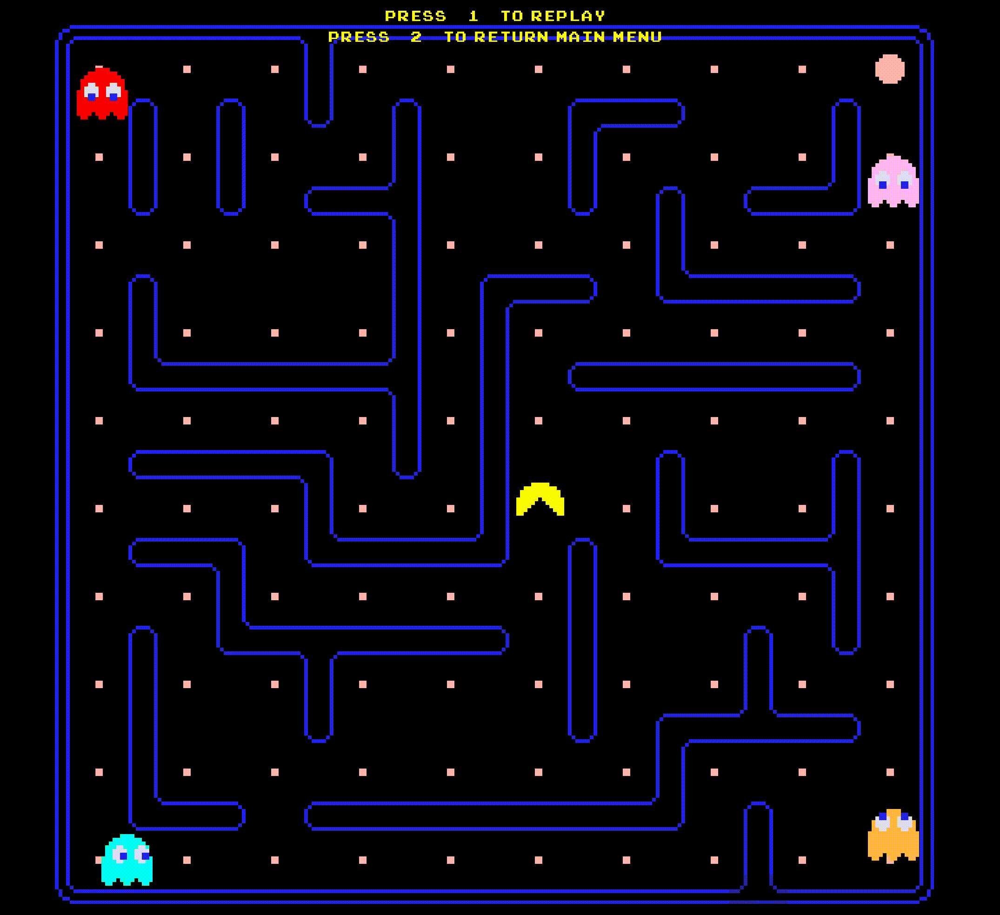
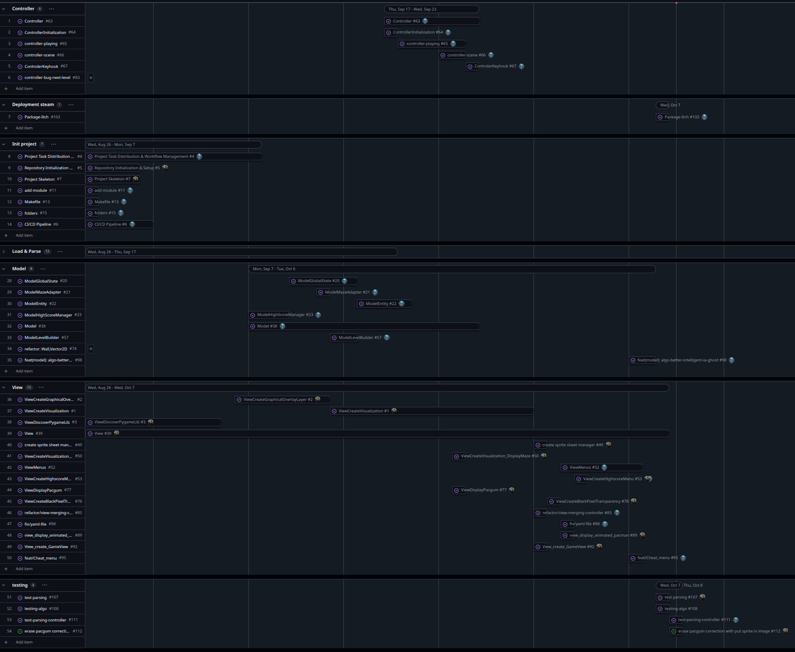

*This project has been created as part of the 42 curriculum by yriffard, advacher.*
## Description
This project is a playable recreation of the classic arcade game PacMan. Built in Python 3.14, a strict Model-View-Controller (MVC) architecture, and use MiniLibX functions equivalence using Pygame as graphical library. The game features : graphical UI, persistent highscores, autonomous ghost AI, and dynamic level generation.

## Preview



## Instructions
**Installation & Setup:**  
This project relies on `uv` for package management and uses Python >=3.14 features.  
Dependencies can be installed via the provided Makefile using 
```bash
make install
```

**Execution:**  
The game must be launched from the command line, taking exactly one argument (a JSON configuration file).
```bash
uv run python3 pac-man.py config.json
```
Or using
```bash
make run 
```

**Cleaning:**  
The environment can be clean by the provided Makefile using
```bash
make clean
```

**Packaging:**  
The Makfile run the package.sh command and build the package using
```bash
make package 
```

**Debugging:**
Similar to run command the Makefile can run the pdb debugger using
```bash
make debug 
```


## Configuration
The game is configured via a JSON file that supports inline comments (starting with #). A config.json is furnished. If invalid or missing values are encountered, the game clamps to safe defaults and logs a clear message without crashing or displaying a Python traceback.
Key configuration parameters include:  

* **highscore_filename:** Path to the highscore save file (Default: "highscore.json").

* **lives:** Initial number of player lives (Default: 3, Minimum: 1, Maximum: 10).

* **pacgum:** Number of pacgums required. If the value is too high compared to the maze size, it clamps to a safe value (Default: 42, Minimum: 1).

* **super_pacgum:** Number of super pacgums (Default: 4, Minimum: 1, Maximum: 4).

* **points_per_pacgum:** Points awarded for eating a regular pacgum (Default: 10, Minimum: 1, Maximum: 10).

* **points_per_super_pacgum:** Points awarded for eating a super pacgum (Default: 50, Minimum: 1, Maximum: 50).

* **points_per_ghost:** Points awarded for eating a vulnerable ghost (Default: 200, Minimum: 1, Maximum: 200).

* **level_max_time:** Maximum time allowed per level in seconds (Default: 90, Minimum: 40, Maximum: 3600).

* **seed:** Seed controlling the maze generation (Default: 42).

* **levels:** Array defining multiple levels (Default: 10 levels, Maximum 20).

* **width, height:** Dimensions for each level configuration (Default: 10, Minimum: 10, Maximum: 20).


## Highscore

The game features highscore system managed by the HighScoreManager and JsonModelLoader classes.It retains the top 10 scores alongside player names (limited to a maximum of 10 alphanumeric characters and spaces).  
Scores are stored locally in a JSON format.  
The system loads at the game start to display scores in the Main Menu and ask the player to save their score at the end of a session (Win or Lose).

## Maze GenerationLevel
Maze are generated dynamically using an external assigned A-Maze-ing package.  
The package is used exactly as-is without internal modification.  
The generator's PERFECT parameter is set to False to ensure the creation of looped ,Pac-Man-compatible corridors.  
The first level is generated using a fixed seed (e.g., 42) to ensure first level is the same, while others levels are randomly generated. 

## Implementation
The codebase strictly adheres to the **flake8** coding standard and uses **mypy** for static type checking across all functions. **Exception handling** is implemented using try-except blocks and context managers to ensure graceful failure without application crashes or resource leaks. A **cheat mode** is also implemented to facilitate evaluation.


## General Software Architecture
### **Model:** The logic resides in classes like GameSession, LevelBuilder, GameBoard and Entity. 
* The `GameSession` tracks value update during the party, including the current score, remaining lives, active power mode, and level timers.

* `LevelBuilder` acts as interprets configuration data to construct the maze, determine bounds, and instantiate the initial entities for the GameBoard.

* The `GameBoard` dataclass serves as centralizing to the active level :  
    * `MazeAdapter` (grid data),
    * `PacMan` player entity,
    * `Ghost` list of entities,
    * the coordinate for all `pacgums` and `super-pacgums`.

* `Entity` abstract base class defining base properties, spawn positions, movement vectors, and speed parameters. all entity will herit from this class


### **Controller:** The GameController acts as the orchestrator.  

* Initialized from main() entry point, it loads the configuration, initializes the LevelBuilder and HighScoreManager, captures real-time, updates session timers, and triggers the update(elapsed_time) loop for all active entities.  

* Game loop governed by a state machine (MENU, PLAYING, PAUSED, VICTORY, DEFEAT, ENTER_HIGHSCORE).

* It independently resolves spatial collisions (detecting intersections between the player, collectibles, and ghosts), manages score accruals via the session manager, handles ghost vulnerability transitions, and coordinates entity respawns.

### **View:** The GameView is storing all called method that display the game
The Graphical User Interface (GUI) manages the Main Menu, the HUD (displaying score, lives, current level, and remaining time), the Pause Menu, and the Game Over or Victory screens.

Every visual asset is dynamically extracted and cropped from a single sprite sheet. Each sprite is scaled and rendered by its corresponding scene renderer.

Each scene (e.g., Main Menu, Gameplay) renders its own pixel buffer to the screen. Scenes are structured into a series of layered components. These components are blitted sequentially like stacked layers, using a colorkey mechanism (treating black pixels as transparent) to prevent covering underlying elements.

To optimize rendering, this blitting pipeline relies on a custom MiniLibX-style wrapper built on top of Pygame. On initialization, sprite sheets are loaded into a Pygame/NumPy surface buffer. When a sprite needs to be drawn, the required sub-region is sliced from the array buffer and blitted directly onto the active display window.

## Needed Sprites
To ensure optimal visual rendering, Pac-Man assets are stored in the sprites/ directory. Each sprite sheet is paired with a corresponding .yaml configuration file storing specific sprite metadata (x/y positions, width, height, animation frame count, frame rate, etc.).

These files are strictly bound to their respective sprite sheets and must not be altered.

## Project Management

The project was managed collaboratively using **GitHub** to ensure structured organization :

* **Planning & Tracking:** The workload was structured and tracked using GitHub **Milestones**, visualized as a Gantt chart style timeline to define key objectives, and manage deliverables.
* **Development Workflow:** Daily development relied on a strict branch-based workflow utilizing **Pull Requests (PRs)**. This enabled continuous peer review, ensuring code quality, knowledge sharing.

You can find all project management documents, tracking sheets, and related resources in the [dedicated project management directory](https://github.com/users/casyr/projects/3/views/4).


| contributors| Issues | Pull request |
| --- | --- | --- |
| 2 | `112` | 55 |


**poject overview**




## Ressources

Here is the function-by-function mapping from MiniLibX (mlx) to Pygame.

Because MiniLibX relies on an event-driven hook system in C while Pygame uses an object-oriented Python structure with an explicit main loop, the approaches differ slightly in practice.

| MiniLibX Function | Pygame Equivalent | Notes / Differences |
| --- | --- | --- |
| **Initialization** |  |  |
| `mlx_init` | `pygame.init()` | Initializes all imported Pygame modules. |
| `mlx_new_window` | `pygame.display.set_mode((w, h))` | Creates the display window and returns the main screen `Surface`. |
| `mlx_clear_window` | `screen.fill((R, G, B))` | Fills a Surface (e.g., screen) with a specific color. |
| `mlx_destroy_window` | `pygame.display.quit()` | Uninitializes the display module and closes the window. |
| **Image functions** |  |  |
| `mlx_new_image` | `pygame.Surface((w, h))` | Creates a new blank image/surface in memory. |
| `mlx_get_data_addr` | `pygame.surfarray.pixels2d()` | Accesses pixel data directly as arrays or raw memory buffers. |
| `mlx_put_image_to_window` | `screen.blit(image_surface, (x, y))` | Draws one Surface onto another (e.g., onto the screen). Requires calling `pygame.display.flip()` to render. |
| `mlx_destroy_image` | `del image_surface` | Memory is freed automatically by Python's Garbage Collector when references are removed. |
| **Hooks / Loop** |  |  |
| `mlx_key_hook` | `pygame.event.get()` loop | Handled via `pygame.KEYDOWN` and `pygame.KEYUP` event types. |
| `mlx_loop_hook` | `while running:` loop body | Code inside the explicit main loop runs every frame. |
| `mlx_loop` | `while running:` + `pygame.time.Clock().tick(FPS)` | Pygame does not hide the loop behind a callback framework; you write the explicit `while` loop. |
| **Image conversions** |  |  |
| `mlx_png_file_to_image` | `pygame.image.load("file.png")` | Natively loads PNG images from disk. |
| **Un-categorized** |  |  |
| `mlx_do_sync` |  `pygame.display.update()` | Updates the full display surface to the screen. |

### documentation

- [MLX functions](https://harm-smits.github.io/42docs/libs/minilibx/prototypes.html)
- [pygame documentation](https://www.pygame.org/docs/)
- [Game Programming Pattern - Robert Nystrom](https://gameprogrammingpatterns.com/contents.html)
- [Pacman sprite](https://www.spriters-resource.com/arcade/pacman/asset/52631/)
 